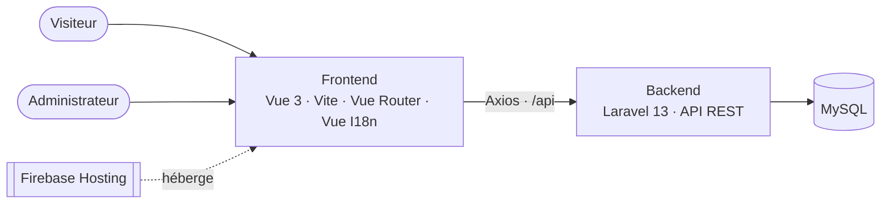

<div align="center">

#  Site Vitrine Multilingue pour un Cabinet d'expertise AzkExpertise


**AzkExpertise** est une application web métier conçue pour faciliter la gestion des données liées à une activité d’expertise. Le projet vise à proposer une interface moderne et réactive, tout en séparant le frontend du backend grâce à une architecture composée d’une **API REST** et d’une **application SPA**.


🇫🇷 Français · 🇲🇦 العربية · 🇬🇧 English

</div>

---

> 🔒 **Note de confidentialité :** ce projet a été réalisé en freelance pour un cabinet de conseil. Le nom du client, ses coordonnées, ses identifiants et ses contenus internes ne figurent volontairement pas dans ce dépôt. Les noms utilisés ici (dossiers, base de données) sont génériques.

---

## 📋 Fiche projet

| | |
| :--- | :--- |
| **Type** | Projet freelance, site web professionnel sur mesure |
| **Client** | Cabinet de conseil et d'expertise technique (confidentiel) |
| **Mission** | Conception, développement front et back, mise en ligne |
| **Langues du site** | Français, arabe, anglais |
| **Architecture** | Frontend Vue.js 3 + API REST Laravel 13 |
| **Hébergement du frontend** | Firebase Hosting |

---

## 🎯 Le besoin

Le cabinet voulait une présence en ligne **crédible et professionnelle** pour :

- présenter clairement ses pôles de services ;
- toucher une clientèle francophone, arabophone et anglophone ;
- recevoir les demandes de contact de façon structurée, sans passer par une simple adresse e-mail ;
- accéder à un espace privé pour gérer les demandes reçues.

## ✅ Ce qui a été livré

### Pour les visiteurs

| Fonctionnalité | Détail |
| :--- | :--- |
| **Pages de services** | Une page par pôle d'activité, construites à partir de composants réutilisables |
| **Présentation du cabinet** | Entreprise, valeurs et positionnement |
| **Formulaire de contact** | Envoi via l'API Laravel, les demandes sont enregistrées en base |
| **Multilingue FR / AR / EN** | Interface complète, changement de langue à la volée |

### Pour l'administrateur

| Fonctionnalité | Détail |
| :--- | :--- |
| **Espace protégé** | Accès réservé après authentification |
| **Gestion des contacts** | Consultation des demandes reçues |
| **Réinitialisation du mot de passe** | Parcours dédié |
| **Traduction des textes** | Gérée par l'API Laravel |

---

## 🧱 Architecture



| Couche | Rôle | Technologies |
| :--- | :--- | :--- |
| **Frontend** | Interface, navigation, traductions | Vue.js 3, Vite, Vue Router, Vue I18n, Axios, Font Awesome |
| **Backend** | Authentification, contacts, traduction, mots de passe | PHP 8.3+, Laravel 13 |
| **Base de données** | Comptes, contacts, contenus | MySQL |
| **Déploiement** | Mise en ligne du site statique | Firebase Hosting |

### Structure du dépôt

```text
cabinet-web/
├── backend/            # API Laravel
│   ├── app/            #   logique métier (contrôleurs, modèles)
│   ├── routes/         #   routes de l'API
│   ├── database/       #   migrations
│   └── .env.example    #   modèle de configuration (sans valeurs réelles)
├── frontend/           # Application Vue.js
│   ├── src/            #   pages, composants, traductions
│   ├── public/
│   └── vite.config.js  #   proxy /api vers Laravel
├── firebase.json       # Configuration Firebase Hosting
└── README.md
```

---

## 🚀 Démarrage rapide

**Prérequis :** PHP ≥ 8.3 · Composer · Node.js ≥ 22 · npm · MySQL · Git

```bash
git clone <url-du-repo>
cd cabinet-web
```

<details>
<summary><b>1. Backend Laravel</b></summary>

```bash
cd backend
composer install
cp .env.example .env
php artisan key:generate
```

Crée la base de données :

```sql
CREATE DATABASE IF NOT EXISTS cabinet_web CHARACTER SET utf8mb4 COLLATE utf8mb4_unicode_ci;
```

Renseigne l'accès dans `.env` (valeurs d'exemple, à remplacer par les tiennes) :

```env
APP_NAME=CabinetWeb
APP_ENV=local
APP_DEBUG=true
APP_URL=http://localhost:8000

DB_CONNECTION=mysql
DB_HOST=127.0.0.1
DB_PORT=3306
DB_DATABASE=cabinet_web
DB_USERNAME=<utilisateur>
DB_PASSWORD=<mot-de-passe>
```

Puis lance les migrations et le serveur :

```bash
php artisan migrate
php artisan serve        # → http://localhost:8000
```

</details>

<details>
<summary><b>2. Frontend Vue.js</b></summary>

Dans un second terminal :

```bash
cd frontend
npm install
npm run dev              # → http://localhost:5173
```

Le fichier `vite.config.js` redirige les appels `/api` vers le backend Laravel : aucune configuration supplémentaire en développement.

</details>

### Vérifier que tout fonctionne

1. Ouvre `http://localhost:5173`.
2. Change de langue (FR / AR / EN) et parcours les pages de services.
3. Envoie un message depuis le formulaire de contact et vérifie qu'il apparaît dans la base.
4. Connecte-toi à l'espace d'administration.

---

## 🌍 Mise en ligne

### Frontend

```bash
cd frontend
npm run build            # génère frontend/dist
cd ..
firebase deploy
```

### ⚠️ Backend

**Firebase Hosting ne sert que des fichiers statiques.** Il héberge donc le frontend, mais pas l'API Laravel. En production, le backend doit être déployé sur un hébergement compatible PHP et MySQL, et le frontend doit pointer vers l'URL de cette API à la place du proxy local.

### 🔐 Sécurité et confidentialité

| Point | Bonne pratique |
| :--- | :--- |
| `.env` | Jamais versionné : vérifie qu'il figure dans `.gitignore` |
| Clés et identifiants | Jamais dans le code ni dans le README |
| `APP_ENV` / `APP_DEBUG` | `production` / `false` en ligne |
| Mot de passe de la base | Fort, jamais vide |
| Données des visiteurs | Demandes de contact stockées uniquement en base, jamais dans le dépôt |
| CORS | Autoriser uniquement le domaine du frontend |
| Fichiers Firebase | `.firebaserc` et règles : ne pas publier d'identifiants de projet réels si le dépôt est public |

---

## 🛠️ Pistes d'évolution

- Notification par e-mail à chaque nouvelle demande de contact.
- Tableau de bord administrateur avec statistiques de visites et de demandes.
- Édition des contenus du site depuis l'espace d'administration.
- Optimisation du référencement (balises, sitemap, métadonnées par langue).
- Tests automatisés (PHPUnit côté Laravel, Vitest côté Vue).

---

## 👩‍💻 Développement

Projet conçu et développé en freelance par **Fatima Chegdani**, élève ingénieure en Génie Informatique et Intelligence Artificielle — ENSA Safi.

[](https://www.linkedin.com/in/fatima-chegdani-44b840274)
[](https://github.com/Fatima1234-cheg)

---

## 📄 Licence

Projet réalisé pour le compte d'un client. Les droits d'utilisation et de distribution lui appartiennent : toute réutilisation du code ou des contenus nécessite son accord.
